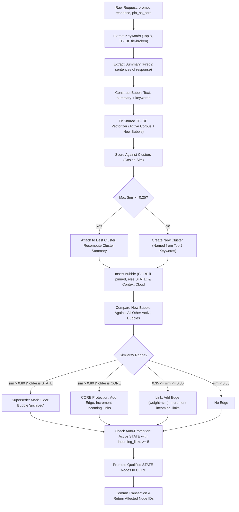
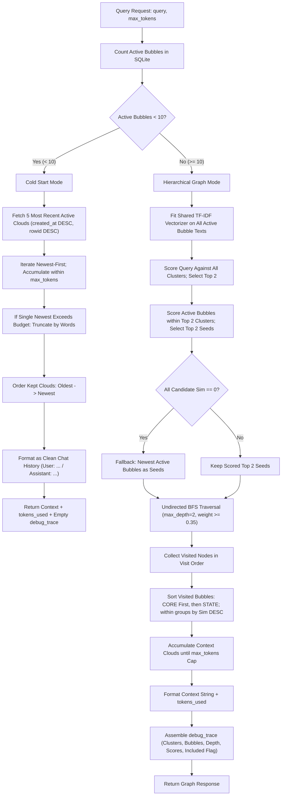

# HairyGraph Architecture & System Design

HairyGraph is a local-first, hierarchical graph memory service designed to provide persistent semantic retrieval for autonomous agents and LLM applications without relying on external cloud APIs or heavyweight vector databases.

This document details the internal architecture, data pipelines, storage model, graph lifecycle mechanics, and engineering trade-offs of the system.

---

## 1. System Overview & Core Philosophy

HairyGraph operates under three primary design tenets:
1. **Zero External Runtime Dependencies**: All keyword extraction, extractive summarization, and vector similarity operations execute locally using deterministic algorithms and standard mathematical libraries (`scikit-learn`, `numpy`).
2. **Hierarchical Coarse-to-Fine Traversal**: Rather than executing global flat searches across every raw interaction, retrieval routes through broad thematic clusters down to localized bubble neighborhoods and linked conceptual nodes.
3. **Strict Memory Budgeting**: Returned context strictly obeys token limits via deterministic word-to-token projections, preventing prompt overflow during downstream LLM inference.

---

## 2. End-to-End Data Flow

### 2.1 Ingestion Pipeline (`POST /save_memory`)

When an interaction pair (`prompt`, `response`) is submitted, the ingestion engine executes an atomic database transaction through the following stages:



### 2.2 Retrieval & Traversal Pipeline (`POST /get_context`)

Retrieval operates conditionally based on total active knowledge scale:



---

## 3. SQLite WAL Schema & Storage Architecture

HairyGraph persists all state in a single SQLite database configured for high-concurrency read scenarios:
- `PRAGMA journal_mode = WAL;`: Write-Ahead Logging allows concurrent readers to proceed without blocking writers, while write transactions lock only during commit serialization.
- `PRAGMA foreign_keys = ON;`: Cascading deletes guarantee data integrity across parent and dependent tables.
- `PRAGMA busy_timeout = 5000;`: Prevents transient write-lock exceptions under concurrent bursts.

### 3.1 DDL Schema

```sql
-- 1. Semantic Clusters
CREATE TABLE IF NOT EXISTS clusters (
    id TEXT PRIMARY KEY,
    name TEXT NOT NULL,
    summary TEXT NOT NULL,
    created_at TIMESTAMP NOT NULL
);

-- 2. Conceptual Bubbles
CREATE TABLE IF NOT EXISTS bubbles (
    id TEXT PRIMARY KEY,
    cluster_id TEXT NOT NULL REFERENCES clusters(id) ON DELETE CASCADE,
    keywords TEXT NOT NULL,          -- JSON list of strings
    summary TEXT NOT NULL,           -- Extractive sentence summary
    node_type TEXT NOT NULL CHECK (node_type IN ('CORE', 'STATE')),
    status TEXT NOT NULL CHECK (status IN ('active', 'archived')),
    incoming_links INTEGER NOT NULL DEFAULT 0,
    created_at TIMESTAMP NOT NULL
);

-- 3. Raw Context Clouds (1:1 with Bubbles)
CREATE TABLE IF NOT EXISTS context_clouds (
    id TEXT PRIMARY KEY,
    bubble_id TEXT NOT NULL UNIQUE REFERENCES bubbles(id) ON DELETE CASCADE,
    raw_prompt TEXT NOT NULL,
    raw_response TEXT NOT NULL,
    full_text TEXT NOT NULL,
    token_estimate INTEGER NOT NULL,
    created_at TIMESTAMP NOT NULL
);

-- 4. Weighted Undirected Graph Links
CREATE TABLE IF NOT EXISTS bubble_links (
    source_bubble_id TEXT NOT NULL REFERENCES bubbles(id) ON DELETE CASCADE,
    target_bubble_id TEXT NOT NULL REFERENCES bubbles(id) ON DELETE CASCADE,
    weight REAL NOT NULL CHECK (weight >= 0.0 AND weight <= 1.0),
    PRIMARY KEY (source_bubble_id, target_bubble_id)
);

-- Indexes for FK validation, status queries, and ordering
CREATE INDEX IF NOT EXISTS idx_bubbles_cluster_id ON bubbles(cluster_id);
CREATE INDEX IF NOT EXISTS idx_context_clouds_bubble_id ON context_clouds(bubble_id);
CREATE INDEX IF NOT EXISTS idx_bubble_links_source ON bubble_links(source_bubble_id);
CREATE INDEX IF NOT EXISTS idx_bubble_links_target ON bubble_links(target_bubble_id);
CREATE INDEX IF NOT EXISTS idx_bubbles_status_node_type ON bubbles(status, node_type);
CREATE INDEX IF NOT EXISTS idx_bubbles_status_created ON bubbles(status, created_at DESC);
```

### 3.2 Ordering and Microsecond Tie-Breaking
All timestamps are recorded in ISO 8601 UTC with microsecond precision (`strftime('%Y-%m-%dT%H:%M:%f')`). Where strict determinism is required (e.g. determining the newest bubble or latest state node for `/archive_last`), queries combine timestamp ordering with the implicit SQLite table row identifier:
```sql
ORDER BY b.created_at DESC, b.rowid DESC
```

### 3.3 Dense Vector Serialization (`embedding BLOB`)
To support hybrid search or dense semantic embeddings (e.g. `BAAI/bge-small-en-v1.5`, 384 dimensions) alongside lexical TF-IDF, vector embeddings are serialized as contiguous raw 32-bit floating point binary buffers (`float32` byte buffers):

```python
import numpy as np

# Serialization to SQLite BLOB
def serialize_embedding(embedding: np.ndarray) -> bytes:
    # Ensure float32 contiguous array
    return np.ascontiguousarray(embedding, dtype=np.float32).tobytes()

# Zero-copy deserialization from SQLite BLOB
def deserialize_embedding(blob: bytes) -> np.ndarray:
    return np.frombuffer(blob, dtype=np.float32)
```

**Benefits of Raw BLOB Serialization**:
- **Compact Footprint**: 384 dimensions at 4 bytes each require exactly 1,536 bytes per row, compared to ~4.5 KB when serialized as JSON strings.
- **Zero-Copy Memory Mapping**: `np.frombuffer` instantiates a typed NumPy array pointing directly to SQLite's memory allocation without parsing overhead.
- **SIMD Acceleration**: Serialized arrays can be stacked directly into contiguous 2D matrices (`N x D`) for vectorized matrix-vector dot products using BLAS/AVX2 intrinsics.

---

## 4. Graph Lifecycle Mechanics

### 4.1 Node Types: `STATE` vs `CORE`
- **`STATE` (Transient Working Memory)**: Ephemeral, step-by-step observations, ongoing dialogue turns, or temporary task states. Subject to deduplication, supersede rules, and manual archiving (`/archive_last`).
- **`CORE` (Consolidated Knowledge)**: Foundational facts, permanent project constraints, or system rules. Explicitly pinned via `pin_as_core=True` or autonomously promoted. `CORE` nodes are **immutable against automated deletion or supersede archiving**.

### 4.2 Supersede Rule (`sim > 0.80`)
When a new memory has a cosine similarity $> 0.80$ against an existing `STATE` node:
- The older `STATE` node is marked `archived`.
- No link is established, and no incoming link counts are updated.
- The new node effectively supersedes outdated knowledge, preventing semantic drift and repetitive memory accumulation.

### 4.3 CORE Protection Mechanism
If a new memory shares $> 0.80$ similarity with an existing `CORE` node:
- The `CORE` node **remains active and intact**.
- A link edge is generated between the new node and the `CORE` node with `weight = similarity`.
- The `CORE` node's `incoming_links` counter is incremented, reinforcing its centrality in the knowledge graph.

### 4.4 Associative Linking (`0.35 <= sim <= 0.80`)
Pairs falling within $[0.35, 0.80]$ represent semantically related but non-redundant ideas:
- An undirected edge is inserted into `bubble_links`.
- The target node's `incoming_links` attribute is incremented by 1.

### 4.5 Auto-Promotion Threshold (`incoming_links >= 5`)
State nodes that are repeatedly linked to from newly ingested memories represent central concepts rather than fleeting state:
- Upon completing edge insertion in `/save_memory`, any active `STATE` node with `incoming_links >= 5` is transitioned to `node_type = 'CORE'`.

### 4.6 Cold Start vs Graph Mode Threshold (`count < 10`)
- **Scale $\le 9$**: Graph relationships are too sparse for reliable clustering and multi-hop traversal. The service buffers recent interactions linearly as a temporal sliding window.
- **Scale $\ge 10$**: Hierarchical coarse-to-fine graph retrieval activates.
- **Reversibility**: Archiving nodes via superseding or `/archive_last` can decrease the active count below 10, instantly returning the system to cold start mode.

---

## 5. Architectural Trade-offs

### 5.1 Single-Tenant SQLite Concurrency Boundaries
- **Choice**: SQLite in WAL mode with connection-per-request lifecycle.
- **Trade-off**: While WAL mode enables non-blocking concurrent reads, write operations (`/save_memory`, `/archive_last`) require an exclusive write lock.
- **Rationale**: Memory agents operating locally or per-session generate write events at human or conversational cadences (1–5 writes/second). SQLite eliminates database server installation, configuration, and maintenance while delivering $< 2\text{ms}$ query latency on local NVMe/SSD storage.

### 5.2 Flat Dot-Product Vector Scanning vs Approximate Nearest Neighbor (ANN)
- **Choice**: Exact flat similarity computation via `scikit-learn` / `numpy` dot-products over filtered cluster candidates rather than HNSW / IVFPQ indexes.
- **Trade-off**: Exact flat scan has $O(N)$ computational complexity compared to $O(\log N)$ for ANN graphs.
- **Rationale**: In conversational memory stores ($N \le 50,000$ bubbles), computing dot products between a 384-dimensional query and 50,000 vectors takes $< 8\text{ms}$ in NumPy. Flat scanning guarantees 100% recall accuracy, zero index build latency, zero index corruption risk, and zero external vector index dependencies.

### 5.3 Token Budgeting: Whitespace Ratio vs BPE Tokenizers
- **Choice**: Mathematical estimation using word ratios:
  $$\text{tokens} = \left\lceil \frac{\text{word\_count}}{0.75} \right\rceil, \quad \text{max\_words} = \left\lfloor \text{max\_tokens} \times 0.75 \right\rfloor$$
- **Trade-off**: Whitespace heuristics slightly overestimate tokens for code or special character sequences compared to exact BPE tokenizers (`tiktoken` / `cl100k_base`).
- **Rationale**: The $0.75$ divisor acts as a conservative upper bound for English prose and chat dialogues. Overestimating guarantees that retrieved context **never exceeds the prompt token envelope**, eliminating runtime dependency on tokenizer binaries.
